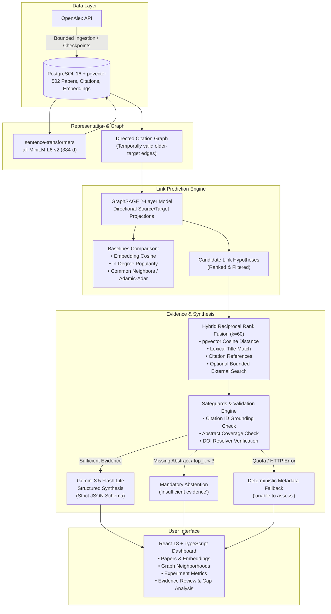

# ResearchGraph AI

## Read-only Render portfolio demo

The frontend includes an optional static demo that does not contact the backend, OpenAlex, or an LLM. It uses a curated snapshot of paper titles, OpenAlex links, years, and 18 citation relationships from `backend/reports/citation_temporal_audit.csv`, plus the recorded Phase 4.5 and 5.5 evaluation reports. The graph is a sample, not the complete corpus. Results are precomputed, and a predicted citation is not a confirmed research gap. The existing Docker application remains the default.

To preview locally from `frontend`, set `VITE_DEMO_MODE=true` and run `npm run dev` or `npm run build`. In PowerShell: `$env:VITE_DEMO_MODE='true'; npm run build`. Clear that variable before building the regular backend-connected application.

For a Render **Static Site**, use these settings (do not add secrets):

| Setting | Value |
| --- | --- |
| Root directory | `frontend` |
| Build command | `npm ci && npm run build` |
| Publish directory | `dist` |
| Environment variable | `VITE_DEMO_MODE=true` |

Vite uses the `/` base path. This interface does not use URL-based client routing. Render static sites have included free usage, but bandwidth and build minutes are limited at the workspace level; exceeding included usage can incur charges if billing is enabled. Review the current Render pricing and workspace limits before deploying. Deployment is not performed by these instructions.

An evidence-grounded research gap exploration system that combines scientific paper metadata from OpenAlex, pinned dense semantic embeddings with pgvector, GraphSAGE link prediction over citation networks, hybrid reciprocal-rank fusion evidence retrieval, and structured generative hypothesis synthesis via Google Gemini Flash-Lite.

---

## Architecture Overview



---

## Technology Stack

| Layer | Technologies | Role in System |
|---|---|---|
| **Database** | PostgreSQL 16, pgvector (`0.5.1`) | Relational persistence, JSON metadata, 384-dimensional vector similarity search |
| **Backend API** | FastAPI (`0.115+`), Uvicorn, Pydantic v2 | High-performance asynchronous API, input bounds, concurrency locks |
| **Database ORM & Migrations** | SQLAlchemy 2.0, Alembic | Schema versioning (9 migrations), advisory locking, migration management |
| **Embeddings** | `sentence-transformers` (`all-MiniLM-L6-v2`) | Revision-pinned dense text embeddings on CPU (PyTorch 2.15) |
| **Graph Neural Network** | PyTorch Geometric (`torch-geometric 2.8.1`), NetworkX | 2-layer GraphSAGE link prediction, random edge splits, directional projections |
| **Baselines & Metrics** | Scikit-learn, NumPy, SciPy | Cosine, popularity, common neighbors, Adamic–Adar, ROC-AUC, MRR, Hits@k |
| **LLM Provider** | Google Gemini API (`gemini-3.5-flash-lite`) | Constrained structured synthesis via Google AI Studio unbilled free tier |
| **Frontend** | React 18, TypeScript 5.6, Vite 8, Lucide React | Interactive research dashboard, graph visualization, evidence review UI |
| **Testing** | Pytest 9.2 (backend), Vitest 5.1 (frontend) | 44 backend tests (100% pass), 7 frontend component tests (100% pass) |
| **Containerization** | Docker, Docker Compose | Multi-container orchestration, persistent named volumes, health checks |

---

## Key System Components

1. **Corpus & Embeddings**:
   - Ingests verified scientific papers and citation metadata from OpenAlex with deduplication on DOI and OpenAlex IDs.
   - Pinned embedding model: `sentence-transformers/all-MiniLM-L6-v2` at revision `1110a243fdf4706b3f48f1d95db1a4f5529b4d41`, producing normalized 384-dimensional vectors stored in PostgreSQL via `pgvector`.
2. **Citation Graph & GraphSAGE Experiments**:
   - Directional citation graph filtering: only citations where target publication year is strictly earlier than source publication year are eligible positive edges.
   - 2-layer mean-aggregation GraphSAGE network with ReLU, dropout, gradient clipping (1.0), validation-loss early stopping, and separate directional projection layers.
   - Compared against four classical link prediction baselines: embedding cosine similarity, in-degree popularity, common neighbors, and Adamic–Adar index.
3. **Hybrid Evidence Retrieval**:
   - Reciprocal Rank Fusion ($k=60$) combining semantic pgvector vector distance, lexical title-keyword matching, OpenAlex citation references, and optional bounded external OpenAlex queries.
   - Bounded context: maximum 8 evidence records, 12,000 UTF-8 bytes, and 1,500 characters per abstract.
4. **Structured Generative Synthesis & Safeguards**:
   - Optional hosted synthesis powered by allowlisted `gemini-3.5-flash-lite` on Google AI Studio's unbilled free tier.
   - Strict JSON Schema output with Pydantic (`extra='forbid'`).
   - Grounding validation: every assertion must cite valid evidence IDs (`E1`, `E2`, etc.); hallucinated IDs, raw URLs, and unverified DOIs in generated text are rejected.
   - Mandatory abstention: automatically triggers `insufficient evidence` if abstract coverage is below threshold or evidence records $< 3$.
   - Daily rate ledger: local database table `generation_attempts` hard-caps hosted requests to $\le 5$ per UTC day before dispatch.
   - Fallback guarantee: automatic graceful degradation to `DeterministicProvider` with recorded error reason upon any HTTP error or rate limit.

---

## Important Scientific Limitations

> [!WARNING]
> ### Rigorous Scientific Guardrails
> 1. **GraphSAGE Does NOT Outperform the Popularity Baseline**: In rigorous repeated evaluations across 5 random splits, target citation in-degree (popularity) outperforms GraphSAGE on top ranking metrics (Popularity MRR $\approx 0.068$, Hits@10 $\approx 0.147$ vs. GraphSAGE MRR $\approx 0.046$, Hits@10 $\approx 0.090$). GraphSAGE captures non-trivial structural signal beyond cosine similarity, but heavily cited seminal papers dominate citation acquisition in practice.
> 2. **Exploratory Random Splits, NOT Prospective Evaluation**: Splits are random 70/15/15 partitions of eligible older-target citation edges. They do not simulate forward-time prospective discovery across calendar cutoffs.
> 3. **Uncalibrated Model Hypotheses**: Model scores represent uncalibrated link prediction likelihoods, NOT verified missing citations or proof of a scientific research gap.
> 4. **No Claim of Scientific Novelty**: Generated hypotheses and validation designs are tentative, abstract-level suggestions. They are NOT scientifically validated discoveries. Absence of a citation edge in OpenAlex is not evidence of absence in literature. Full-text peer review is strictly required.

---

## Real Evaluation Results Summary

### GraphSAGE Link Prediction (Experiment 9 & Phase 4.5 5-Seed Evaluation)
- **Corpus**: 502 papers, 1,300 candidate link hypotheses.
- **Classification Performance**:
  - GraphSAGE ROC-AUC: $0.835 \pm 0.018$
  - GraphSAGE Average Precision: $0.833 \pm 0.023$
- **Ranking Performance Across Older Candidates**:
  - GraphSAGE MRR: $0.046 \pm 0.009$ (vs. Popularity baseline: $0.068 \pm 0.010$)
  - GraphSAGE Hits@10: $0.090 \pm 0.021$ (vs. Popularity baseline: $0.147 \pm 0.025$)
  - Cosine Similarity baseline MRR: $0.035 \pm 0.005$

### Phase 5.5 Gemini Structured Generation Evaluation
- **Demonstration 1 (Analysis 8 — Structured Hypothesis)**:
  - Candidate: MolGpKa (`W3181755904`) → Neural Message Passing for Quantum Chemistry (`W2606780347`).
  - Outcome: `review_status: "existing related research found"`.
  - Generated Hypothesis: *"Integrating the graph-convolutional architecture used in MolGpKa with the generalized Message Passing Neural Network (MPNN) framework can improve the predictive accuracy of molecular pKa estimation across diverse chemical datasets compared to using standard fingerprint-based machine learning models alone."* Grounded to citations `["E1", "E2"]`.
  - Latency: 10.08s (2,062 prompt tokens, 535 output tokens).
- **Demonstration 2 (Analysis 9 — Missing Abstract Safeguard)**:
  - Candidate: MD-GNN (`W4375946946`) → MPNN (`W2606780347`).
  - Condition: E1 source paper had metadata only (no abstract).
  - Outcome: Model strictly abstained (`review_status: "insufficient evidence"`, hypothesis and experiment null, uncertainty citing `["E1", "E2"]`).
- **Demonstration 3 (Analysis 10 — Restricted Budget Safeguard)**:
  - Candidate: Decoupling Depth and Scope (`W3214086726`) → MPNN (`W2606780347`) with `top_k=2`.
  - Outcome: Model strictly abstained (`review_status: "insufficient evidence"`).
- **Demonstration 4 (Analysis 7 — Deterministic Fallback)**:
  - Condition: Provider error simulation.
  - Outcome: Graceful fallback to `DeterministicProvider` with `fallback_reason: "Gemini request failed with HTTP 404"`.

---

## Environment Variables Reference

| Variable | Default Value | Required | Purpose |
|---|---|:---:|---|
| `POSTGRES_DB` | `researchgraph` | No | PostgreSQL database name |
| `POSTGRES_USER` | `researchgraph` | No | PostgreSQL username |
| `POSTGRES_PASSWORD` | None | Yes | Unique local PostgreSQL password; use the same value in `DATABASE_URL` |
| `POSTGRES_PORT` | `5432` | No | Host port mapped to PostgreSQL container (set to `55432` if occupied) |
| `BACKEND_PORT` | `8000` | No | Host port mapped to FastAPI backend (set to `8002` if occupied) |
| `DATABASE_URL` | `postgresql+psycopg://...` | Yes | SQLAlchemy database connection string |
| `OPENALEX_API_KEY` | `""` | No | Free OpenAlex API key for collection and search |
| `EMBEDDING_CPU_THREADS` | `2` | No | PyTorch CPU thread allocation for text embeddings (capped at 8) |
| `ANALYSIS_PROVIDER` | `deterministic` | No | Default analysis provider (`deterministic` or `gemini`) |
| `GEMINI_API_KEY` | `""` | No | Google AI Studio free-tier API key |
| `GEMINI_FREE_TIER_CONFIRMED` | `false` | No | User confirmation that the key belongs to an unbilled project |
| `GEMINI_MODEL` | `gemini-3.5-flash-lite` | No | Allowlisted Gemini Flash-Lite model identifier |
| `GEMINI_DAILY_REQUEST_LIMIT` | `5` | No | Hard daily request limit per UTC day (capped at 5) |
| `CORS_ORIGINS` | `["http://localhost:5173"]` | No | Allowed CORS browser origins (JSON string array) |
| `VITE_API_BASE_URL` | `http://localhost:8000` | No | Frontend API base URL (must match host `BACKEND_PORT`) |

---

## Quickstart with Docker Compose

### Prerequisites
- Docker Engine & Docker Compose
- No paid API required (free OpenAlex key and free-tier Gemini key optional)

### 1. Configuration
Copy the template configuration:
```sh
cp .env.example .env
```
Replace `REPLACE_WITH_UNIQUE_PASSWORD` in both `POSTGRES_PASSWORD` and `DATABASE_URL` with the same strong, unique password. Keep `.env` private. For URL-special characters, percent-encode the password in `DATABASE_URL`. Ensure ports in `.env` match your host preferences (e.g. `POSTGRES_PORT=55432`, `BACKEND_PORT=8002`). PostgreSQL is exposed only on localhost. Changing `POSTGRES_PASSWORD` after the database has been initialized does not rotate the existing role password; update the PostgreSQL role separately.

### 2. Start Services
```sh
docker compose up -d --build
```
This starts:
- `db`: PostgreSQL 16 with pgvector extension (persisted in volume `postgres_data`).
- `backend`: FastAPI application running Alembic migrations and Uvicorn.
- `frontend`: React + Vite dashboard.

### 3. Verify Health
- Web UI: http://localhost:5173
- API Health: http://localhost:8002/health
- API Docs: http://localhost:8002/docs

---

## Local Development & Testing

### Backend Setup
```sh
cd backend
python -m venv .venv
# On Windows PowerShell:
.\.venv\Scripts\Activate.ps1
# On Linux/macOS:
source .venv/bin/activate

pip install -r requirements-dev.txt
```

### Running Backend Tests Safely
To run the full 44-test backend test suite against an isolated test database (protecting demonstration data):
```sh
# Inside the backend container with fail-closed isolation checks:
docker exec researchgraph-ai-backend-1 python /app/run_tests_safely.py
```
Test results: **44 passed, 0 failed, 0 skipped in 14.35s**.

### Frontend Setup & Tests
```sh
cd frontend
npm install
npm test          # Vitest suite: 5 passed (5), 7 passed (7)
npm run build     # TypeScript check (tsc -b) & Vite production build
npm audit         # Security audit: 0 vulnerabilities found
```

---

## Core API Endpoints Reference

| Method | Endpoint | Description |
|---|---|---|
| `GET` | `/health` | Process liveness check |
| `GET` | `/api/v1/status` | API version and foundation phase status |
| `GET` | `/api/v1/papers` | Paginated paper metadata search and filtering |
| `POST` | `/api/v1/papers/ingest` | Synchronous ingestion of selected OpenAlex paper IDs |
| `POST` | `/api/v1/collections` | Start background OpenAlex collection job (bounded to 1,000 papers) |
| `POST` | `/api/v1/embeddings/generate` | Generate 384-d pgvector embeddings in batches of 16 |
| `GET` | `/api/v1/graph/summary` | Citation, authorship, and topic edge counts |
| `GET` | `/api/v1/graph/neighborhood` | Bounded graph neighborhood centered on a paper |
| `POST` | `/api/v1/experiments` | Run single-process GraphSAGE CPU link prediction experiment |
| `GET` | `/api/v1/experiments/{id}/candidates` | Filtered, ranked candidate citation links with baseline scores |
| `GET` | `/api/v1/analysis/providers` | Active providers, model name, and free-tier status |
| `GET` | `/api/v1/analysis/evidence` | Hybrid Reciprocal Rank Fusion evidence retrieval |
| `POST` | `/api/v1/analyses` | Dispatch structured evidence analysis with advisory lock |
| `GET` | `/api/v1/analyses/{id}` | Detailed analysis result, claims, synthesis, and limitations |
| `GET` | `/api/v1/analyses/{id}/citations/{cid}/verify` | Un-redirected HEAD check against DOI resolver |

---

## End-to-End Interview Demonstration Workflow

Follow these steps to demonstrate the end-to-end pipeline during an interview or review:

1. **Dashboard & Status**:
   - Open http://localhost:5173. The dashboard connects to `/health` and `/api/v1/status`.
2. **Literature Exploration (Papers Page)**:
   - View the 502 ingested papers spanning molecular modeling, quantum chemistry, and graph neural networks.
   - Inspect semantic search powered by 384-dimensional pgvector cosine distance.
3. **Knowledge Graph Exploration (Graph Page)**:
   - Explore paper neighborhoods. Clarify that edges reflect real OpenAlex co-authorship, citation references, and query topics.
4. **GraphSAGE Experiments (Experiments Page)**:
   - Select completed **Experiment 9**.
   - Show the evaluation curves (loss early stopping at 14 epochs).
   - Point out the baseline metrics: explicitly highlight that the **Popularity baseline out-ranks GraphSAGE** (Hits@10 0.147 vs 0.090), illustrating rigorous evaluation honesty.
5. **Candidate Analysis & Evidence Review (Evidence Review Page)**:
   - Select Candidate 1: MolGpKa (`#240`) → MPNN (`#460`).
   - Click **Inspect Evidence** to view the reciprocal rank fusion combining semantic distance, lexical overlap, and OpenAlex citation links.
   - Click **Check DOI Resolver** on E1 to verify live HTTP 302 HEAD resolution without following redirects.
6. **Gemini Hypothesis & Safeguard Demonstrations**:
   - Open **Analysis 8**: Review the Gemini Flash-Lite structured hypothesis and validation experiment with citations `[E1, E2]`.
   - Open **Analysis 9**: Review the **abstention safeguard** when source paper lacks an abstract.
   - Open **Analysis 10**: Review the **abstention safeguard** under a restricted evidence budget (`top_k=2`).
   - Open **Analysis 7**: Review the **deterministic fallback** handling when a provider error occurs.

---

## Limitations & Future Roadmap

- **Prospective Evaluation Benchmark**: Implement calendar cutoff splits (e.g. training on literature published $\le 2020$, evaluating on prospective citations formed in $2021–2024$) to measure forward temporal prediction.
- **Full-Text Integration**: Integrate open-access full-text PDFs (via PMC or arXiv bulk data) to ground claims in methods and experimental sections rather than abstract-level metadata.
- **Calibrated Probability Scores**: Train Platt scaling or isotonic regression on validation predictions to provide calibrated gap likelihood probabilities rather than raw uncalibrated scores.
- **Cross-Domain Transfer**: Evaluate whether structural GraphSAGE embeddings transfer across disparate scientific subdomains (e.g., materials science to organic synthesis).

---

## Security & Ethics
- **No Hardcoded Secrets**: All API keys, passwords, and tokens are stored in the ignored `.env` and excluded from Git.
- **Fail-Closed Free-Tier Protection**: Hosted generation requires explicit confirmation (`GEMINI_FREE_TIER_CONFIRMED=true`) and is capped at 5 attempts per UTC day.
- **Safe Outbound Connectivity**: The application only contacts authoritative APIs (OpenAlex and Google AI Studio) and performs strictly un-redirected HEAD checks on `doi.org`.
