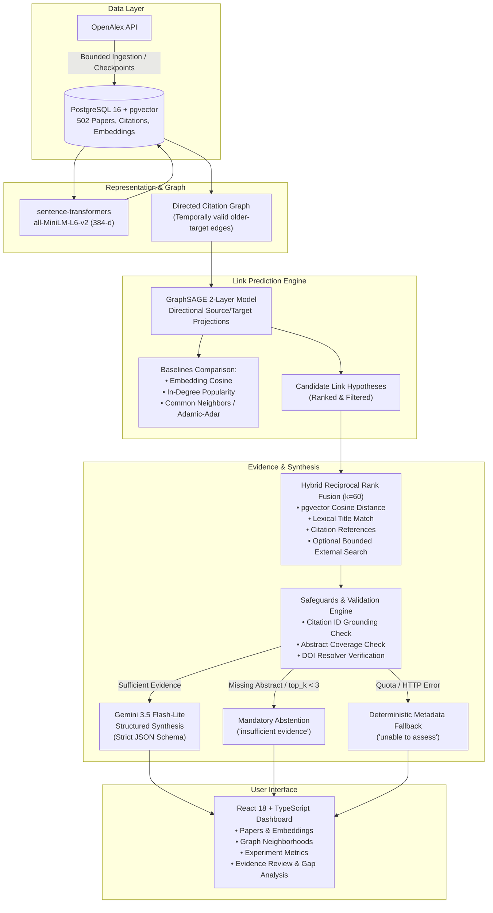

# ResearchGraph AI

An evidence-grounded research gap exploration system that combines scientific paper metadata from OpenAlex, pinned dense semantic embeddings with pgvector, GraphSAGE link prediction over citation networks, hybrid reciprocal-rank fusion evidence retrieval, and structured generative hypothesis synthesis via Google Gemini Flash-Lite.

---

## Architecture Overview



---

## Key System Components

1. **Corpus & Embeddings**:
   - Ingests verified scientific papers and citation metadata from OpenAlex with deduplication on DOI and OpenAlex IDs.
   - Pinned embedding model: `sentence-transformers/all-MiniLM-L6-v2` at revision `1110a243fdf4706b3f48f1d95db1a4f5529b4d41`, producing normalized 384-dimensional vectors stored in PostgreSQL via `pgvector`.
2. **Citation Graph & GraphSAGE Experiments**:
   - Directional citation graph filtering: only citations where target publication year is strictly earlier than source publication year are eligible positive edges.
   - 2-layer mean-aggregation GraphSAGE network with ReLU, dropout, gradient clipping (1.0), validation-loss early stopping, and separate directional projection layers.
   - Compared against four classical link prediction baselines: embedding cosine similarity, in-degree popularity, common neighbors, and Adamic–Adar index.
3. **Hybrid Evidence Retrieval**:
   - Reciprocal Rank Fusion ($k=60$) combining semantic pgvector vector distance, lexical title-keyword matching, OpenAlex citation references, and optional bounded external OpenAlex queries.
   - Bounded context: maximum 8 evidence records, 12,000 UTF-8 bytes, and 1,500 characters per abstract.
4. **Structured Generative Synthesis & Safeguards**:
   - Optional hosted synthesis powered by allowlisted `gemini-3.5-flash-lite` on Google AI Studio's unbilled free tier.
   - Strict JSON Schema output with Pydantic (`extra='forbid'`).
   - Grounding validation: every assertion must cite valid evidence IDs (`E1`, `E2`, etc.); hallucinated IDs, raw URLs, and unverified DOIs in generated text are rejected.
   - Mandatory abstention: automatically triggers `insufficient evidence` if abstract coverage is below threshold or evidence records $< 3$.
   - Daily rate ledger: local database table `generation_attempts` hard-caps hosted requests to $\le 5$ per UTC day before dispatch.
   - Fallback guarantee: automatic graceful degradation to `DeterministicProvider` with recorded error reason upon any HTTP error or rate limit.

---

## Important Scientific Limitations

> [!WARNING]
> ### Rigorous Scientific Guardrails
> 1. **GraphSAGE Does NOT Outperform the Popularity Baseline**: In rigorous repeated evaluations across 5 random splits, target citation in-degree (popularity) outperforms GraphSAGE on top ranking metrics (Popularity MRR $\approx 0.068$, Hits@10 $\approx 0.147$ vs. GraphSAGE MRR $\approx 0.046$, Hits@10 $\approx 0.090$). GraphSAGE captures non-trivial structural signal beyond cosine similarity, but heavily cited seminal papers dominate citation acquisition in practice.
> 2. **Exploratory Random Splits, NOT Prospective Evaluation**: Splits are random 70/15/15 partitions of eligible older-target citation edges. They do not simulate forward-time prospective discovery across calendar cutoffs.
> 3. **Uncalibrated Model Hypotheses**: Model scores represent uncalibrated link prediction likelihoods, NOT verified missing citations or proof of a scientific research gap.
> 4. **No Claim of Scientific Novelty**: Generated hypotheses and validation designs are tentative, abstract-level suggestions. They are NOT scientifically validated discoveries. Absence of a citation edge in OpenAlex is not evidence of absence in literature. Full-text peer review is strictly required.

---

## Real Evaluation Results Summary

### GraphSAGE Link Prediction (Experiment 9 & Phase 4.5 5-Seed Evaluation)
- **Corpus**: 502 papers, 1,300 candidate link hypotheses.
- **Classification Performance**:
  - GraphSAGE ROC-AUC: $0.835 \pm 0.018$
  - GraphSAGE Average Precision: $0.833 \pm 0.023$
- **Ranking Performance Across Older Candidates**:
  - GraphSAGE MRR: $0.046 \pm 0.009$ (vs. Popularity baseline: $0.068 \pm 0.010$)
  - GraphSAGE Hits@10: $0.090 \pm 0.021$ (vs. Popularity baseline: $0.147 \pm 0.025$)
  - Cosine Similarity baseline MRR: $0.035 \pm 0.005$

### Phase 5.5 Gemini Structured Generation Evaluation
- **Demonstration 1 (Analysis 8 — Structured Hypothesis)**:
  - Candidate: MolGpKa (`W3181755904`) → Neural Message Passing for Quantum Chemistry (`W2606780347`).
  - Outcome: `review_status: "existing related research found"`.
  - Generated Hypothesis: *"Integrating the graph-convolutional architecture used in MolGpKa with the generalized Message Passing Neural Network (MPNN) framework can improve the predictive accuracy of molecular pKa estimation across diverse chemical datasets compared to using standard fingerprint-based machine learning models alone."* Grounded to citations `["E1", "E2"]`.
  - Latency: 10.08s (2,062 prompt tokens, 535 output tokens).
- **Demonstration 2 (Analysis 9 — Missing Abstract Safeguard)**:
  - Candidate: MD-GNN (`W4375946946`) → MPNN (`W2606780347`).
  - Condition: E1 source paper had metadata only (no abstract).
  - Outcome: Model strictly abstained (`review_status: "insufficient evidence"`, hypothesis and experiment null, uncertainty citing `["E1", "E2"]`).
- **Demonstration 3 (Analysis 10 — Restricted Budget Safeguard)**:
  - Candidate: Decoupling Depth and Scope (`W3214086726`) → MPNN (`W2606780347`) with `top_k=2`.
  - Outcome: Model strictly abstained (`review_status: "insufficient evidence"`).
- **Demonstration 4 (Analysis 7 — Deterministic Fallback)**:
  - Condition: Provider error simulation.
  - Outcome: Graceful fallback to `DeterministicProvider` with `fallback_reason: "Gemini request failed with HTTP 404"`.

---

## Quickstart with Docker Compose

### Prerequisites
- Docker Engine & Docker Compose
- No paid API required (free OpenAlex key and free-tier Gemini key optional)

### 1. Configuration
Copy the template configuration:
```sh
cp .env.example .env
```
Ensure ports `55432` (or `5432`) and `8002` (or `8000`) in `.env` match your host preferences.

### 2. Start Services
```sh
docker compose up -d --build
```
This starts:
- `db`: PostgreSQL 16 with pgvector extension (persisted in volume `postgres_data`).
- `backend`: FastAPI application running Alembic migrations and Uvicorn.
- `frontend`: React + Vite dashboard.

### 3. Verify Health
- Web UI: http://localhost:5173
- API Health: http://localhost:8002/health
- API Docs: http://localhost:8002/docs

---

## Local Development & Testing

### Backend Setup
```sh
cd backend
python -m venv .venv
# On Windows PowerShell:
.\.venv\Scripts\Activate.ps1
# On Linux/macOS:
source .venv/bin/activate

pip install -r requirements-dev.txt
```

### Running Backend Tests Safely
To run the full 44-test backend test suite against an isolated test database (protecting demonstration data):
```sh
# Inside the backend container with fail-closed isolation checks:
docker exec researchgraph-ai-backend-1 python /app/run_tests_safely.py
```
Test results: **44 passed, 0 failed, 0 skipped in 14.35s**.

### Frontend Setup & Tests
```sh
cd frontend
npm install
npm test          # Vitest suite: 5 passed (5), 7 passed (7)
npm run build     # TypeScript check (tsc -b) & Vite production build
npm audit         # Security audit: 0 vulnerabilities found
```

---

## End-to-End Interview Demonstration Workflow

Follow these steps to demonstrate the end-to-end pipeline during an interview or review:

1. **Dashboard & Status**:
   - Open http://localhost:5173. The dashboard connects to `/health` and `/api/v1/status`.
2. **Literature Exploration (Papers Page)**:
   - View the 502 ingested papers spanning molecular modeling, quantum chemistry, and graph neural networks.
   - Inspect semantic search powered by 384-dimensional pgvector cosine distance.
3. **Knowledge Graph Exploration (Graph Page)**:
   - Explore paper neighborhoods. Clarify that edges reflect real OpenAlex co-authorship, citation references, and query topics.
4. **GraphSAGE Experiments (Experiments Page)**:
   - Select completed **Experiment 9**.
   - Show the evaluation curves (loss early stopping at 14 epochs).
   - Point out the baseline metrics: explicitly highlight that the **Popularity baseline out-ranks GraphSAGE** (Hits@10 0.147 vs 0.090), illustrating rigorous evaluation honesty.
5. **Candidate Analysis & Evidence Review (Evidence Review Page)**:
   - Select Candidate 1: MolGpKa (`#240`) → MPNN (`#460`).
   - Click **Inspect Evidence** to view the reciprocal rank fusion combining semantic distance, lexical overlap, and OpenAlex citation links.
   - Click **Check DOI Resolver** on E1 to verify live HTTP 302 HEAD resolution without following redirects.
6. **Gemini Hypothesis & Safeguard Demonstrations**:
   - Open **Analysis 8**: Review the Gemini Flash-Lite structured hypothesis and validation experiment with citations `[E1, E2]`.
   - Open **Analysis 9**: Review the **abstention safeguard** when source paper lacks an abstract.
   - Open **Analysis 10**: Review the **abstention safeguard** under a restricted evidence budget (`top_k=2`).
   - Open **Analysis 7**: Review the **deterministic fallback** handling when a provider error occurs.

---

## Security & Ethics
- **No Hardcoded Secrets**: All API keys, passwords, and tokens are stored in the ignored `.env` and excluded from Git.
- **Fail-Closed Free-Tier Protection**: Hosted generation requires explicit confirmation (`GEMINI_FREE_TIER_CONFIRMED=true`) and is capped at 5 attempts per UTC day.
- **Safe Outbound Connectivity**: The application only contacts authoritative APIs (OpenAlex and Google AI Studio) and performs strictly un-redirected HEAD checks on `doi.org`.
